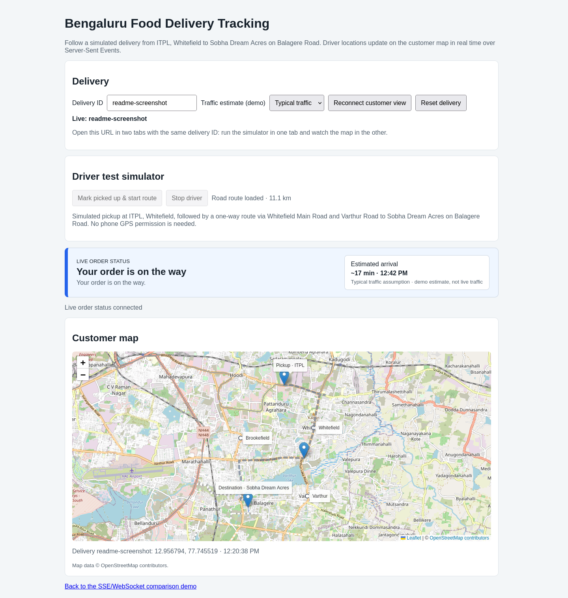

## Spring SSE vs WebSocket Demo

This project is a minimal Spring Boot application that exposes two real-time APIs side by side so you can compare **Server-Sent Events (SSE)** and **WebSockets**.

- SSE endpoint: `GET /sse`
- WebSocket endpoint: `ws://localhost:8080/ws`
- Demo UI: `GET /` (serves `src/main/resources/static/index.html`)

Java code is organized by responsibility under `com.we13ailab.ssedemo`: `controller`, `service`, `dto.request`, `dto.response`, `model`, `config`, `websocket`, and `util`.

Spring Boot version: `4.1.1`
Java version: `21` (see `pom.xml` properties)

---

## Running the Application

From the project root:

```bash
./mvnw spring-boot:run
```

If you use a system Maven instead of the wrapper:

```bash
mvn spring-boot:run
```

The app starts on `http://localhost:8080` by default.

---

## Demo UI

Open:

```text
http://localhost:8080/
```

The page has two panels:

1. **SSE panel**
   - Buttons: `Connect`, `Disconnect`.
   - On connect, the browser opens an `EventSource` to `/sse` and logs messages.

2. **WebSocket panel**
   - Buttons: `Connect`, `Disconnect`, `Send test message`.
   - On connect, the browser opens a `WebSocket` to `/ws`, logs messages, and you can send a sample message to see the echo.

This lets you see the behavior, payloads, and timing differences side by side.

The food-delivery location demo is available at:

```text
http://localhost:8080/tracking.html
```



---

## Live Food-Delivery Tracking Demo

The tracking flow uses a driver-to-server HTTP `POST` and server-to-customer SSE stream:

1. The driver simulator posts a latitude and longitude every second, starting at ITPL in Whitefield.
2. Spring stores the latest location per delivery in memory.
3. Spring broadcasts each update to customer browsers connected to that delivery's SSE stream.
4. The tracking page moves the driver marker on a Leaflet map.

The map uses Leaflet with free OpenStreetMap tiles and displays the required attribution. On page load, it requests the full driving geometry from the public OSRM demo router (`router.project-osrm.org`); the driver simulation sends points along that road geometry so the marker and blue traveled line follow mapped roads rather than straight lines between hand-picked coordinates. Both map tiles and routing require internet access. These public services are suitable for this demo, not production traffic; follow their usage policies and use an appropriate hosted provider for production.

### Try it in the browser

1. Start the app and open `http://localhost:8080/tracking.html`.
2. Keep the default delivery ID `demo-order-1` or choose another ID.
3. Click **Mark picked up & start route**. The page advances the order through pickup and on-the-way, then sends driver locations every second.
4. Watch the marker and coordinates update on the map.
5. At arrival, share the OTP shown in the customer status banner with the driver and enter it in the driver OTP form to complete delivery.
6. To see separate driver and customer clients, open the same tracking URL in two tabs with the same delivery ID. Run the simulator in one tab; the other tab receives live status and location updates.
7. Click **Reset delivery** to clear the route progress and OTP and restart the order at **Ready for pickup**. The status banner and reset control are directly above the map area.

The simulated delivery travels from ITPL, Whitefield to Sobha Dream Acres on Balagere Road. Whitefield, Brookefield, and Varthur are labeled on the map. The route comes from OpenStreetMap road data via OSRM; it is a test route, not actual driver GPS data or live traffic routing.

The status banner also shows a remaining ETA. Select **Light**, **Typical**, or **Heavy traffic** to see the demo estimate adjust as the driver progresses along the route. OSRM's free demo router provides a baseline route duration, not live traffic conditions; the traffic multipliers here are illustrative. A truly traffic-aware ETA requires a traffic data provider/API key and is not claimed by this demo.

### Location APIs

Post a driver location:

```bash
curl -X POST http://localhost:8080/api/deliveries/demo-order-1/location -H 'Content-Type: application/json' -d '{"latitude":12.9877152,"longitude":77.7369166}'
```

Get the latest location:

```bash
curl http://localhost:8080/api/deliveries/demo-order-1/location
```

Watch the live event stream (run in a separate terminal, then post locations):

```bash
curl -N http://localhost:8080/api/deliveries/demo-order-1/events
```

Each event contains JSON similar to:

```json
{
  "deliveryId": "demo-order-1",
  "latitude": 12.9877152,
  "longitude": 77.7369166,
  "timestamp": "2026-10-20T12:00:00Z"
}
```

Coordinates outside latitude `-90..90` or longitude `-180..180` are rejected. `GET /location` returns `404` until the first location has been posted.

### Live order status and OTP

The status banner begins at **Order is ready for pickup** and receives updates over its own SSE connection. The simulated flow broadcasts **Order picked up**, **Your order is on the way**, and **Your delivery person has reached your location**. On arrival the server generates a 4-digit OTP; the customer banner shows it to share with the driver. The driver submits the code in the OTP form. Only a correct OTP changes the status to **Order delivered successfully**; an incorrect code is rejected.

Status endpoints:

- `GET /api/deliveries/{deliveryId}/status` — retrieve current status.
- `GET /api/deliveries/{deliveryId}/status/events` — subscribe to live status updates.
- `POST /api/deliveries/{deliveryId}/status/picked-up` — mark the order picked up.
- `POST /api/deliveries/{deliveryId}/status/on-the-way` — mark the driver en route.
- `POST /api/deliveries/{deliveryId}/status/arrived` — mark arrival and generate the OTP.
- `POST /api/deliveries/{deliveryId}/status/verify-otp` — verify JSON body `{"otp":"1234"}`.
- `POST /api/deliveries/{deliveryId}/reset` — clear the saved location and OTP and return status to ready for pickup; connected pages receive reset/status events.

For example, to watch the live status stream:

```bash
curl -N http://localhost:8080/api/deliveries/demo-order-1/status/events
```

Reset and replay the demo order:

```bash
curl -X POST http://localhost:8080/api/deliveries/demo-order-1/reset
```

### Automated real-time update test

The integration tests verify location broadcasts and the status/OTP happy path, including that an incorrect OTP is rejected and a correct one completes the delivery:

```bash
./mvnw -Dtest=DeliveryTrackingIntegrationTest test
```

Locations and active SSE subscribers are held in application memory. They are lost on restart and are not shared between multiple app instances. This demo has no authentication; use authenticated delivery/customer access and durable storage before using a similar flow in production.

---

## Docker

Build and run with Docker Compose:

```bash
docker compose up --build
```

Open `http://localhost:8080/`. Select another Spring profile or host port if needed:

```bash
SPRING_PROFILES_ACTIVE=test APP_PORT=8081 docker compose up --build
```

The image is built from the Maven project in a Java 21 build stage and runs as a non-root user. There are no database or broker containers because this demo stores state in memory.

---

## Spring Profiles and Helm/Kubernetes

Spring profile configuration lives in:

- `src/main/resources/application.yml` (shared defaults)
- `src/main/resources/application-dev.yml`
- `src/main/resources/application-test.yml`
- `src/main/resources/application-prod.yml`

The Helm chart is under `helm/ssedemo/`, with environment-specific overrides in `values-dev.yaml`, `values-test.yaml`, and `values-prod.yaml`. Lint and render the chart:

```bash
helm lint helm/ssedemo
helm template ssedemo-dev helm/ssedemo -f helm/ssedemo/values-dev.yaml
```

Install an environment (replace the namespace/host/image values to match your cluster):

```bash
helm upgrade --install ssedemo-dev helm/ssedemo --namespace ssedemo-dev --create-namespace -f helm/ssedemo/values-dev.yaml

helm upgrade --install ssedemo-test helm/ssedemo --namespace ssedemo-test --create-namespace -f helm/ssedemo/values-test.yaml

helm upgrade --install ssedemo-prod helm/ssedemo --namespace ssedemo-prod --create-namespace -f helm/ssedemo/values-prod.yaml
```

For local access without ingress, port-forward the service:

```bash
kubectl -n ssedemo-dev port-forward svc/ssedemo-dev 8080:80
```

The chart keeps `replicaCount: 1` in every environment because location, status, and OTP state is in process memory. Increasing replicas would make updates inconsistent across pods. The sample chart uses placeholder image names and ingress hosts; set these to values available in your cluster before deploying. Configure TLS and real hostnames in the environment values for an exposed deployment.

---

## SSE Endpoint (`/sse`)

**Code:** `SseController` (`src/main/java/com/we13ailab/ssedemo/controller/SseController.java`)

Signature:

```java
@GetMapping(path = "/sse", produces = MediaType.TEXT_EVENT_STREAM_VALUE)
public SseEmitter stream() { ... }
```

Behavior:

- When a client calls `GET /sse`, the controller returns an `SseEmitter` with an infinite timeout.
- A scheduled task sends a JSON object every second:

  ```json
  {
    "type": "tick",
    "counter": 1,
    "timestamp": "2024-01-01T12:00:00Z"
  }
  ```

- The emitter is cleaned up on completion, timeout, or error.

### How to Use SSE

Browser (built-in API):

```js
const es = new EventSource('/sse');

es.onmessage = (event) => {
  console.log('SSE:', event.data);
};

es.onerror = () => {
  console.log('SSE error or disconnected');
};
```

`EventSource` handles reconnection automatically by default.

Command line (one-shot request, for debugging headers):

```bash
curl -N http://localhost:8080/sse
```

You will see a continuous stream of events.

### When to Use SSE

SSE is a good fit when:

- You only need **server → client** updates (unidirectional).
- You want a simple API on top of HTTP and easy browser support.
- You are pushing events like:
  - Live logs / status updates.
  - Progress of a long-running job.
  - Live scores or basic real-time dashboards.

SSE is **not** ideal when the client also needs to send arbitrary messages to the server over the same channel; use WebSockets instead.

---

## WebSocket Endpoint (`/ws`)

**Code:**

- Config: `WebSocketConfig` (`src/main/java/com/we13ailab/ssedemo/config/WebSocketConfig.java`)
- Handler: `WsTickHandler` (`src/main/java/com/we13ailab/ssedemo/websocket/WsTickHandler.java`)

Registration:

```java
@Configuration
@EnableWebSocket
public class WebSocketConfig implements WebSocketConfigurer {
    @Override
    public void registerWebSocketHandlers(WebSocketHandlerRegistry registry) {
        registry.addHandler(wsTickHandler, "/ws").setAllowedOrigins("*");
    }
}
```

Handler behavior (`WsTickHandler`):

- On connection:
  - Sends an initial `info` message to confirm the connection.
  - Starts a per-connection task that sends a `tick` message every second:

    ```json
    {
      "type": "tick",
      "counter": 1,
      "timestamp": "2024-01-01T12:00:00Z"
    }
    ```

- On text message from the client:
  - Echoes the message back:

    ```json
    {
      "type": "echo",
      "text": "your client message",
      "timestamp": "..."
    }
    ```

- On close:
  - Cancels that connection's scheduled tick task.

### How to Use WebSockets

Browser:

```js
const socket = new WebSocket('ws://localhost:8080/ws');

socket.onopen = () => {
  console.log('WebSocket opened');
  socket.send('Hello from browser');
};

socket.onmessage = (event) => {
  console.log('WS message:', event.data);
};

socket.onclose = () => {
  console.log('WebSocket closed');
};
```

Command line (example using `wscat`, if installed):

```bash
wscat -c ws://localhost:8080/ws
```

You will see the `info` and `tick` messages, and anything you type will be echoed back.

### When to Use WebSockets

WebSockets are a good fit when:

- You need **full duplex** communication (client ↔ server).
- You are building interactive applications:
  - Chat / messaging.
  - Multiplayer games.
  - Collaborative editors.
  - Dashboards where the client also sends commands or filters.

WebSockets give more control and flexibility, but require explicit reconnection logic and a bit more server-side setup.

---

## SSE vs WebSocket – Summary

**Protocol & Transport**

- **SSE**: HTTP streaming with `Content-Type: text/event-stream`.
- **WebSocket**: Separate WebSocket protocol after an HTTP handshake.

**Directionality**

- **SSE**: Server → client only.
- **WebSocket**: Client ↔ server.

**Browser Support**

- **SSE**: Native via `EventSource` in modern browsers.
- **WebSocket**: Native via `WebSocket` API in modern browsers.

**Reconnection**

- **SSE**: Built-in reconnection in browsers, supports `Last-Event-ID`.
- **WebSocket**: You typically implement reconnection logic yourself.

**Best Use Cases**

- **SSE**: One-way real-time updates, notifications, progress, basic dashboards.
- **WebSocket**: Two-way, low-latency interactive features.

This repository is intentionally small so you can use it as a reference or a starting point when deciding between SSE and WebSockets in a Spring Boot application.
